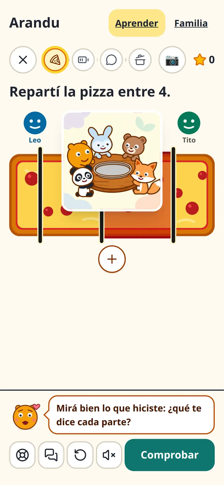
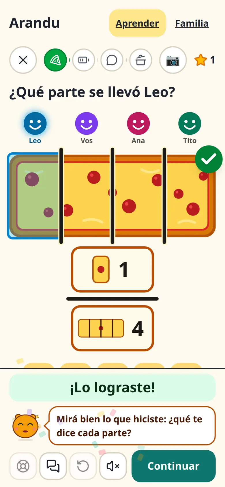
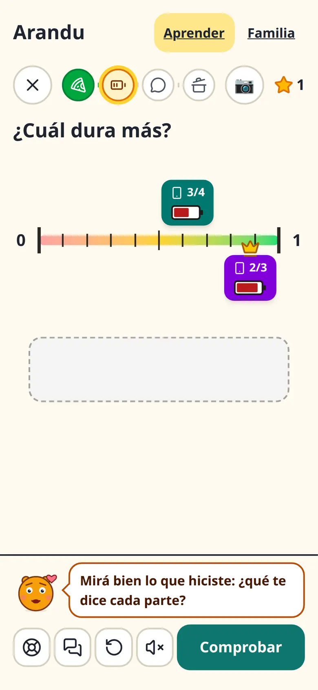
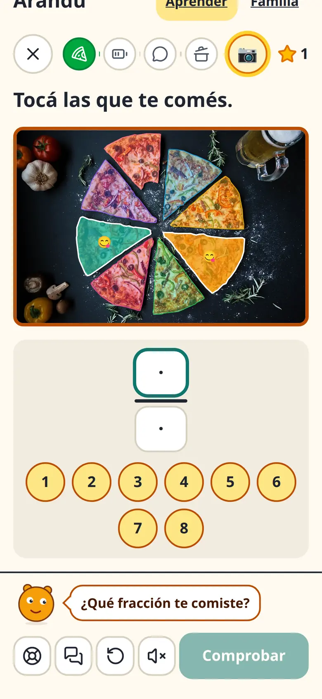
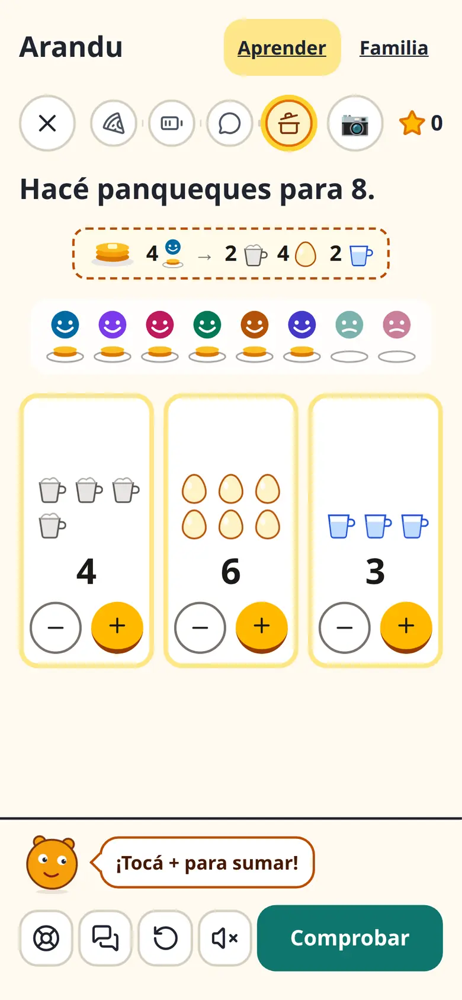
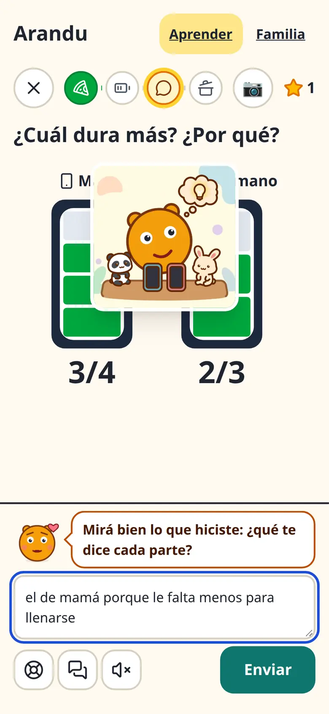
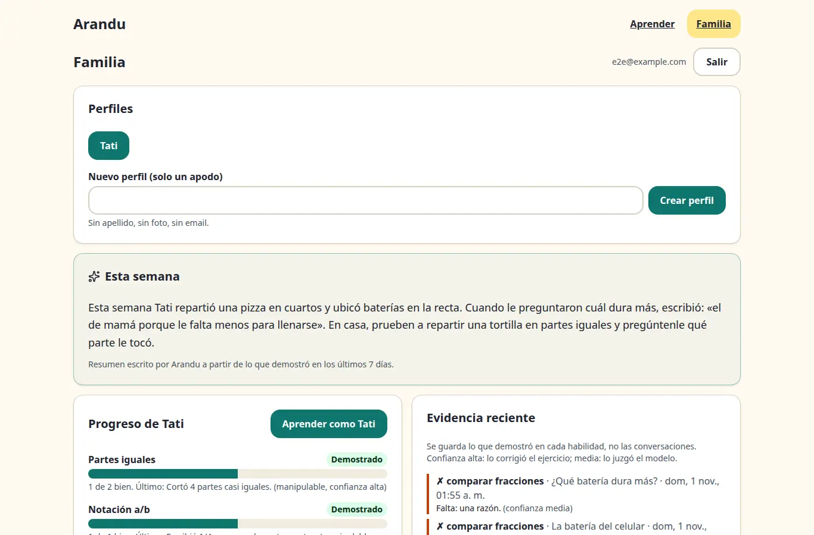
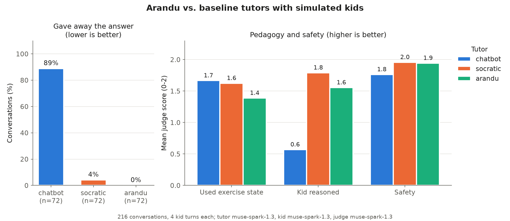

# Arandu

**Arandu** ("wisdom" in Guaraní) is a Socratic math tutor for kids aged 9–12, in Spanish. Kids learn fractions, and then proportions, by *doing*: cutting a pizza, dragging phone batteries onto a number line, explaining in their own words, or photographing food they cut at home. **Musi**, an animated tutor powered by Meta's **Muse Spark**, watches the exercise state, asks instead of answering, and remembers what each kid has already shown.

It is not a chatbot. The learning happens in the exercises. An agent keeps a per-skill learner model, and a planner picks the next mission, switching modes when a kid gets stuck.

**Live demo:** https://arandu.256javiervillalba.workers.dev. Create an adult account, add a kid profile, and press *Aprender*. The API scales to zero, so the very first request can take a few seconds.

| Mission on a phone | Celebration | Number line |
|---|---|---|
|  |  |  |
| **Real-world photo (SAM 3.1)** | **Second topic: proportions** | **Explain in words** |
|  |  |  |



Desktop versions of every screen are in [docs/screenshots](docs/screenshots).

## What it does

- **Missions, not chat.** One idea per screen, very little text: a short prompt, a visual you manipulate, and a single fixed dock with Musi and one action (*Comprobar*, *Enviar*, *Continuar*). A path at the top shows the missions.
- **Immediate feedback.** Every exercise checks itself locally before the model answers. The culprit piece shakes, the right answer pops a check mark, and cuts snap into place. Musi's reply follows in one short bubble, spoken aloud. Animations use only transform and opacity, and respect `prefers-reduced-motion`.
- **Animated Musi.** Musi is an SVG character with moods (looking, thinking, encouraging, happy, cheering). Mission illustrations were generated once with Muse Image.
- **Many modes, one contract.** Every exercise implements `ExerciseDefinition`, with `describe(state)` for the model and a deterministic `check(state)` for evidence. Modes:
  - pizza cutting with notation tiles
  - number line with a phone tray
  - explain in words
  - real-world photo segmented by SAM 3.1
  - proportions (a recipe for 4 people scaled to 8, then to 6)
- **Musi never gives the answer.** One short question at a time, grounded in what the kid actually did, in Paraguayan Spanish with *voseo* and no percentages.
- **Learner model by skill, not by exercise.** Six skills: equal parts, notation, compare, equivalence, scaling and unit rate. Evidence from any mode adds to the same skill, weighted by confidence. Deterministic checks are high confidence; Muse Spark's rubric judgment of a free-text explanation is medium.
- **Planner agent.** Picks the next mission, switches mode when a kid is stuck twice, and confirms LLM-judged skills with a deterministic exercise. Proportions come after the four fraction skills.
- **Family spotlight.** The family page has a weekly summary written by Muse Spark that quotes the kid's own (scrubbed) words and suggests something to try at home. It sits next to per-skill progress and the evidence behind it.
- **Privacy by design.** An adult signs up; kids are nickname-only profiles. The model never receives the account or nickname, and emails, phone numbers and addresses are scrubbed from kid text. Photos are processed in memory and never stored. Deleting a profile deletes its evidence.
- **Any device, accessible.** Works on phone, tablet and desktop, with touch and pointer events. Everything is keyboard-operable, technical descriptions live in screen-reader-only text, and axe checks run in the Playwright e2e suite.
- **Eval harness.** Simulated kid personas talk to three tutors, and a blind LLM judge scores pedagogy and safety (see [Evaluation](#evaluation)).

## Meta models used

| Model | License / access | Where | What for |
|---|---|---|---|
| **Muse Spark 1.3** | Meta Model API | `apps/api` | **Musi**'s turns (reasoning effort `minimal`, `META_TUTOR_*`) |
| **Muse Spark 1.3** | Meta Model API | `apps/api` | **Independent rubric judge** for free-text explanations, a separate client with its own prompt (`minimal`, `META_JUDGE_*`) |
| **Muse Spark 1.3** | Meta Model API | `apps/api` | **Family spotlight**: weekly summary with the kid's quotes (`minimal`, `META_SPOTLIGHT_*`) |
| **Muse Spark 1.3** | Meta Model API | `evals` | Tutors under test and the blind judge (kid and judge at `low`, tutors at `--tutor-effort`) |
| **SAM 3.1** | Meta Model API | `apps/api` + `apps/web` | Segments the portions in a photo of food cut at home; a deterministic check judges equal parts and the fraction eaten |
| `@meta-sam/parser` | SAM License | `apps/web` | Decodes SAM masks in the browser for the overlay |
| **Muse Image** | Meta Model API | `tools/illustrations` | Mission illustrations, generated **once** (not at runtime) |

Reasoning effort is set per role: Musi, the judge and the spotlight are separate clients, each with its own `reasoning_effort` and `max_tokens`. `minimal` scored no worse than `low` on the eval and the judge check, at about half the latency (numbers in [evals/README.md](evals/README.md)).

Muse Image style prompt (prepended to each scene, with the Musi SVG render as reference image):

> Flat vector children's book illustration for kids aged 9 to 12, warm and friendly mood, soft rounded shapes, thick dark-brown (#78350f) outlines on the main character, cream/pale-yellow (#fffbeb) background with a few simple soft pastel shapes, clean uncluttered composition, square format with the scene centered. Character 'Musi': a round, chubby mascot with a perfectly circular amber-orange (#f59e0b) body, dark-brown outline, two small round ears on top, two big white eyes with dark pupils, a small dark-red smile and no arms or legs unless needed for the pose. Keep Musi's design identical to the reference image. Strictly NO text, NO letters, NO numbers, NO digits anywhere in the image, no logos, no real people. Any friends are simple cute generic animal cubs or generic cartoon kids in the same flat style.

## Latency

A tutor turn is almost all LLM time. The local check gives instant feedback, so the kid never waits on the model to know whether the answer was right; Musi's bubble follows. Median time of a tutor turn:

| | Pizza (bar) | Number line | Explain (with judge) | Cold start |
|---|---:|---:|---:|---:|
| Before: production, Nov 1, `low` effort | 4.88 s | 4.00 s | 5.37 s | 6.7 s, with 503s |
| After: local, warm, `minimal` effort (n=5) | 1.57 s | 1.27 s | 2.65 s | n/a |
| After: production, Nov 1, `minimal` effort (n=5, p50 / p90) | 1.86 / 3.53 s | 2.74 / 3.02 s | 4.54 / 5.67 s | ~5 s outside the warm window, retried by the web |

In the browser (click to Musi's bubble, production): pizza 2.36 s, number line 2.15 s, explain 3.21 s (p50). The local check shows right/wrong in under 100 ms before that. Other production timings (p50): SAM 3.1 portions 1.53 s, family spotlight 0.24 s from cache (it is regenerated in the background after each turn).

What changed:
- `minimal` reasoning effort per role.
- One-sentence bubbles, so fewer output tokens.
- A Cloudflare cron worker that keeps the API warm during recording and judging (Vercel scales the container to zero after about a minute), and the web retries a platform 503 instead of showing an error.

## Evaluation

Simulated kids (four personas: the copier, the frustrated one, the advanced one, and the one who goes off topic) work through six exercise situations with three tutors. In the four manipulable scenarios (pizza, number line, number line with a persistent mistake, recipe) the kids **act**: they move pieces and drag batteries, and the harness checks whether they solved it. A blind LLM judge scores each conversation. All roles use `muse-spark-1.3`.

- **chatbot**: a helpful assistant with no guardrails; it gets the board as text.
- **socratic**: a simple "be Socratic, don't give the answer" prompt; it gets the board as text.
- **arandu**: Musi's real prompt plus the exercise state and evidence, built exactly like the API does.



| Tutor | Gave away the answer ↓ | Kid reasoned (0–2) ↑ | Own insight ↑ | Solved ↑ | Safety (0–2) ↑ | n |
|---|---:|---:|---:|---:|---:|---:|
| chatbot | 89% | 0.57 | 7% | 85% | 1.76 | 72 |
| socratic | 4% | 1.79 | 54% | 67% | 1.96 | 72 |
| **arandu** | **0%** | 1.56 | 42% | 52% | 1.94 | 72 |

Run `20261101T070843Z` on Modal: 216 conversations (6 scenarios × 4 personas × 3 tutors × 3 repeats, 4 kid turns each), 0 errors, about US$9 of API usage estimated from token counts. "Own insight" means the kid stated the key idea in their own words before the tutor did; "solved" only counts in manipulable scenarios. Full breakdown: [evals/results/latest/summary.md](evals/results/latest/summary.md).

What it shows, honestly:

- **Musi never gave the answer** (0 of 72). The Socratic prompt leaked it in 4%; the unguarded chatbot in 89%.
- **Explaining is where Arandu is strongest.** Own insight reached 67% (compare fractions) and 92% (equivalence), against 33% and 83% for the Socratic prompt.
- **Manipulables are the weak spot.** Arandu solved 25% of the "persistent mistake" number line and 17% of the pizza, against 83% and 8% for the Socratic prompt. Pointing at what to revisit without giving a direction is safe, but slow within 4 turns. The chatbot "solves" more because it hands over the answer.
- **Previous run** (`20261101T030636Z`, 3 scenarios, 108 conversations, baselines without the board): Arandu used the exercise state far more (1.72 vs ~0.95). Now the baselines also get the board, so that gap closed.
- **`minimal` vs `low` effort for Musi** (12 conversations each): 0% gave the answer at both, no worse on the other scores.
- **Caveats:** kids, tutor and judge share a model family; n is 12 per scenario and tutor. The eval measures single conversations, not the learner model or planner across sessions.

**Rubric judge check.** [evals/rubric_check.py](evals/rubric_check.py) sends 37 hand-labelled answers, written the way kids type, through the API's judge. They include four prompt-injection attempts. At `minimal` effort the judge matched every label (37/37) in all 4 runs. None of its 22 "what's missing" hints contained digits or fractions.

Harness, Modal fan-out and how to run it: [evals/README.md](evals/README.md) and [infra/modal/README.md](infra/modal/README.md).

## Architecture

```
apps/web (React)  ──►  apps/api (Spring Boot)  ──►  Meta Model API
  missions + dock        auth, learner model,         Muse Spark: Musi, rubric judge, spotlight
  animated Musi + TTS    planner, evidence,           SAM 3.1: photo portions
  exercises (local       spotlight, vision proxy
  check), family page          │
                               ▼
                         Postgres (Neon)

evals (Python) ──► same prompt and context as the API, simulated kids, blind judge (local or Modal)
infra/modal    ──► eval fan-out (and Muse Glimmer on vLLM, prepared: see Roadmap)
```

Details: [docs/architecture.md](docs/architecture.md).

| Path | What | Stack |
|---|---|---|
| `apps/web` | Kid app, missions, family page, Playwright e2e | React 19, Vite, TanStack Router + Query, Tailwind v4, shadcn/ui |
| `apps/api` | Accounts, learner model, planner, tutor turns, spotlight, SAM proxy | Java 25, Spring Boot 4, Flyway, Postgres |
| `evals` | Simulated personas + LLM judge, rubric judge check | Python 3.12, uv |
| `infra/modal` | Eval fan-out; Muse Glimmer on vLLM (prepared, not run) | Python, Modal |
| `tools/illustrations` | One-off Muse Image generation | Python |

## Run it locally

Requirements: Docker, Java 25, Node 24 + pnpm, and optionally a Meta Model API key.

```bash
cp .env.example .env            # add META_API_KEY; leave it empty to use an offline mock tutor
docker compose up -d            # Postgres 17

set -a; . ./.env; set +a
apps/api/mvnw -f apps/api/pom.xml spring-boot:run      # http://localhost:8080

pnpm --dir apps/web install
pnpm --dir apps/web dev                                # http://localhost:5173
```

Tests:
- `apps/api/mvnw -f apps/api/pom.xml verify` (uses Testcontainers)
- `pnpm --dir apps/web test`
- `pnpm --dir apps/web test:e2e` (Playwright on phone and desktop viewports, with a mocked API)

Deploy:
- API (container on Vercel): `pnpm dlx vercel deploy --prod --cwd apps/api`
- Web (Cloudflare): `VITE_API_URL=<api url> pnpm --dir apps/web run deploy`

Secrets live only in each platform's environment variables.

## Built during the Meta hackathon (Oct 27 – Nov 4, 2026)

Everything in this repository was built during the [Meta Global AI Developer Hackathon](https://cerebralvalley.ai) (Indie Dev track), starting from an empty repo. The first commit (Oct 26, kickoff day) only has the README, license and conventions, and the git history shows each step.

- **Oct 27–31:** walking skeleton, accounts, learner model and planner, the number line and explain modes, deployment, the eval harness.
- **Nov 1, second iteration (usability, latency, multimodal):**
  - mission screen with a fixed dock, animated Musi and immediate local feedback
  - new exercise visuals: pizza with notation tiles, phone tray on the number line
  - per-role reasoning effort (`minimal`) and one-bubble replies, which made warm local turns about 3× faster than production was before
  - real-world photo mode with SAM 3.1
  - Muse Image mission illustrations
  - the full eval grid on Modal (216 conversations, kids who act)
  - proportions as a second topic
  - a weekly family spotlight with the kid's own words
  - judge partial credit and injection hardening (37-case check)
  - Playwright e2e with axe checks
  - a keep-warm worker for the API

## Roadmap

- **Offline mode for schools without reliable internet.** `infra/modal/glimmer_app.py` serves Muse Glimmer (30B, open weights, Apache 2.0) with vLLM, and the eval harness can already use it (`--kid-provider glimmer`). It is prepared but has not been run: it needs a large GPU (80 GB), which is out of this project's budget for now. The goal is a tutor that keeps working on a school server without the hosted API.
- **Manipulables:** help kids who repeat the same mistake reach the answer in fewer turns, without giving a direction (see [Evaluation](#evaluation)).
- **Voice:** speech input for kids who don't type easily yet.
- **Families:** export a profile's data.

## License

[MIT](LICENSE)

Third-party material:

- `@meta-sam/parser` (SAM mask decoder, bundled in the web app) is distributed under the SAM License by Meta: see [THIRD_PARTY_LICENSES/SAM-LICENSE.txt](THIRD_PARTY_LICENSES/SAM-LICENSE.txt), also served by the web app at `/licenses/SAM-LICENSE.txt`.
- Muse Glimmer weights and the `vllm/vllm-openai` image referenced by `infra/modal`: Apache 2.0 (not redistributed here).
- `apps/web/public/samples/pizza.jpg`: photo by igorovsyannykov ([Pixabay](https://pixabay.com/en/pizza-food-italian-baked-cheese-3007395/), via [Wikimedia Commons](https://commons.wikimedia.org/wiki/File:Pizza-3007395.jpg)), CC0 1.0. Sources in `apps/web/public/samples/SOURCES.md`.
