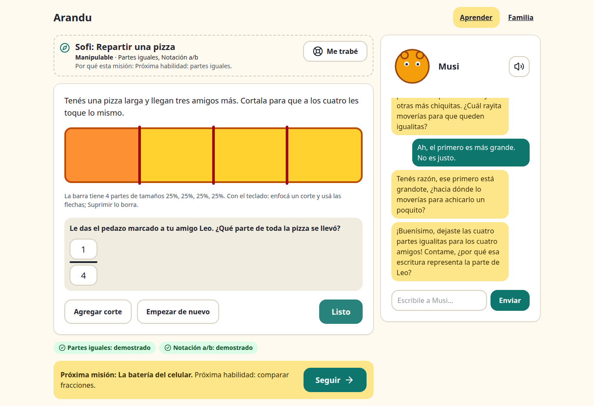
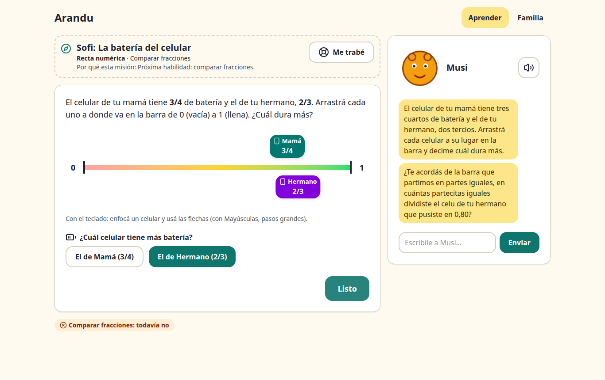
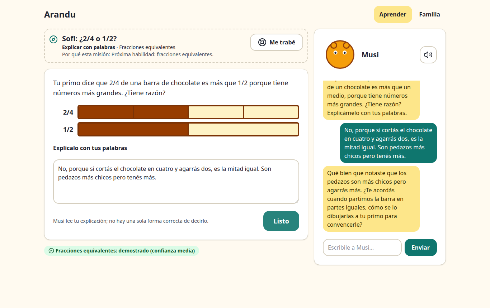
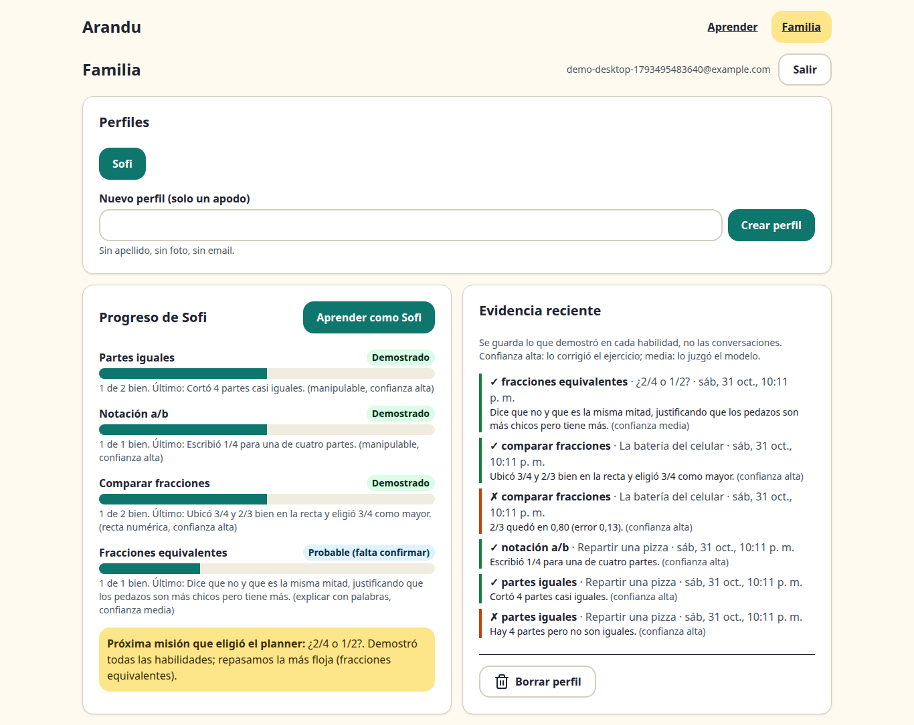

# Arandu

**Arandu** ("wisdom" in Guaraní) is a Socratic math tutor for kids aged 9–12, in Spanish. Kids learn fractions by *doing* (cutting a pizza, placing phone batteries on a number line, explaining in their own words) while **Musi**, a tutor powered by Meta's **Muse Spark**, watches the exercise state, asks instead of answering, and remembers what each kid has already shown.

It is not a chatbot: the learning happens in the exercises, an agent keeps a per-skill learner model, and a planner picks the next mission and switches modes when a kid gets stuck.

**Live demo:** https://arandu.256javiervillalba.workers.dev (create an adult account, add a kid profile, press *Aprender*). The API scales to zero, so the very first request can take a few seconds.

| Manipulable (share a pizza) | Number line (phone batteries) |
|---|---|
|  |  |
| **Explain in words (LLM-judged)** | **Family view (learner model + planner)** |
|  |  |

## What it does

- **Three exercise modes, one contract.** Every exercise implements `ExerciseDefinition` (`describe(state)` for the model, deterministic `check(state)` for evidence). Modes: manipulable bar, number line, explain in words.
- **Musi never gives the answer.** One short question at a time, grounded in what the kid actually did ("you put 2/3 at 0.80…"), in Paraguayan Spanish with *voseo*, spoken aloud with text-to-speech.
- **Learner model by skill, not by exercise.** Equal parts, notation, compare, equivalence. Evidence from any mode adds to the same skill, weighted by confidence: deterministic checks are high confidence, Muse Spark's judgment of a free-text explanation is medium.
- **Planner agent.** Picks the next mission, switches mode when a kid is stuck twice, and confirms LLM-judged skills with a deterministic exercise. Every choice comes with a plain-language reason.
- **Memory across sessions.** Musi is told what the kid showed before ("remember the pizza?") and uses it as a bridge.
- **Accounts with privacy by design.** An adult signs up; kids are nickname-only profiles. The model never receives the account or nickname; emails and phone numbers are scrubbed from kid text. Deleting a profile deletes its evidence.
- **Any device, accessible.** Responsive for phone, tablet and desktop; keyboard-operable sliders, ARIA, large targets. axe reports no WCAG 2.1 AA violations on the main screens.
- **Eval harness.** Simulated kid personas talk to three tutors and an LLM judge scores pedagogy and safety (see [Evaluation](#evaluation)).

## How Meta's models are used

| Model | Where | What for |
|---|---|---|
| Muse Spark 1.3 (Meta Model API) | `apps/api` | Musi's turns; judging free-text explanations against a rubric |
| Muse Spark 1.3 | `evals` | Simulated kids, tutors under test and the judge (kids can optionally run on Muse Spark Open via Fireworks) |
| SAM 3.1 (Meta Model API) | `apps/api` + `apps/web` | "Photo of the real world": segments the portions in a photo of food cut at home; the browser decodes the masks with `@meta-sam/parser` and a deterministic check judges equal parts and the fraction eaten. The photo is processed in memory and never stored (`store=false`, nothing on disk or in logs) |

## Evaluation

Simulated kids (four personas: the copier, the frustrated one, the advanced one, and the one who goes off topic) work through three exercise situations with three tutors. A blind LLM judge scores each conversation. All roles use `muse-spark-1.3`.

- **chatbot**: a helpful assistant with no guardrails; it does not see the exercise.
- **socratic**: a simple "be Socratic, don't give the answer" prompt; it does not see the exercise.
- **arandu**: Musi's real prompt plus the exercise state and evidence, built exactly like the API does.


| Tutor | Gave away the answer ↓ | Used exercise state (0–2) ↑ | Kid reasoned (0–2) ↑ | Safety (0–2) ↑ | n |
|---|---:|---:|---:|---:|---:|
| chatbot | 81% | 0.92 | 1.00 | 1.78 | 36 |
| socratic | 0% | 0.97 | 1.47 | 1.92 | 36 |
| **arandu** | **0%** | **1.72** | 1.39 | **2.00** | 36 |

Run `20261101T030636Z`: 108 conversations, 3 kid turns each, 0 errors, about US$3 of API usage. Full breakdown by persona and scenario: [evals/results/latest/summary.md](evals/results/latest/summary.md).

What it shows, honestly:

- **Grounding is the clear win.** Arandu refers to what the kid actually did far more often (1.72 vs ~0.95), because it sees the exercise state.
- **Musi never gave the answer** in this run, the same as the Socratic baseline; the unguarded chatbot gave it in 81% of conversations. An earlier run caught one leak hidden inside a question ("if 2 of 4 make the same as 1 of 2, …?"), and the prompt now forbids it.
- **"Kid reasoned" is a tie** (1.39 vs 1.47 for the Socratic prompt, within noise at this n). This is the next thing to improve.
- **Caveats:** small n, and the kids, tutor and judge share a model family. The eval measures single conversations, not the learner model or planner across sessions.

The product also uses Muse Spark as a rubric judge for free-text explanations. On 12 hand-labelled answers ([evals/rubric_check.py](evals/rubric_check.py)), it agreed with the label 12 out of 12 times.

Harness, Modal fan-out and how to run it: [evals/README.md](evals/README.md).

## Architecture

```
apps/web (React)  ──►  apps/api (Spring Boot)  ──►  Meta Model API (Muse Spark)
  exercises              auth, learner model,          tutor turns + rubric judging
  Musi panel + TTS       planner, evidence  ──►  Postgres (Neon)
  family view
evals (Python) ──► same prompt and context as the API, simulated kids, LLM judge (local or Modal)
```

Details: [docs/architecture.md](docs/architecture.md).

| Path | What | Stack |
|---|---|---|
| `apps/web` | Kid app, Musi panel, family view | React 19, Vite, TanStack Router + Query, Tailwind v4, shadcn/ui |
| `apps/api` | Accounts, learner model, planner, tutor turns | Java 25, Spring Boot 4, Flyway, Postgres |
| `evals` | Simulated personas + LLM judge | Python 3.12, uv |
| `infra/modal` | Eval fan-out on Modal | Python |

## Run it locally

Requirements: Docker, Java 25, Node 24 + pnpm, and optionally a Meta Model API key.

```bash
cp .env.example .env            # add META_API_KEY; leave it empty to use an offline mock tutor
docker compose up -d            # Postgres 17

set -a; . ./.env; set +a
apps/api/mvnw -f apps/api/pom.xml spring-boot:run      # http://localhost:8080

pnpm --dir apps/web install
pnpm --dir apps/web dev                                # http://localhost:5173
```

Tests: `apps/api/mvnw -f apps/api/pom.xml verify` (uses Testcontainers) and `pnpm --dir apps/web test`.

Deploy: `pnpm dlx vercel deploy --prod --cwd apps/api` (container) and `VITE_API_URL=<api url> pnpm --dir apps/web run deploy` (Cloudflare). Secrets live only in each platform's environment variables.

## Built during the Meta hackathon (Oct 27 – Nov 4, 2026)

Everything in this repository was built during the [Meta Global AI Developer Hackathon](https://cerebralvalley.ai) (Indie Dev track), starting from an empty repo: the first commit (Oct 26, kickoff day) only has the README, license and conventions. The git history shows each step: walking skeleton, accounts, learner model and planner, the number line and explain modes, deployment, and the eval harness.

## License

[MIT](LICENSE)

Third-party material:

- `@meta-sam/parser` (SAM mask decoder, bundled in the web app) is distributed under the SAM License by Meta: see [THIRD_PARTY_LICENSES/SAM-LICENSE.txt](THIRD_PARTY_LICENSES/SAM-LICENSE.txt), also served by the web app at `/licenses/SAM-LICENSE.txt`.
- `apps/web/public/samples/pizza.jpg`: photo by igorovsyannykov ([Pixabay](https://pixabay.com/en/pizza-food-italian-baked-cheese-3007395/), via [Wikimedia Commons](https://commons.wikimedia.org/wiki/File:Pizza-3007395.jpg)), CC0 1.0. Sources in `apps/web/public/samples/SOURCES.md`.
